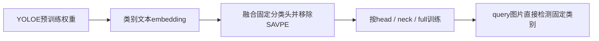
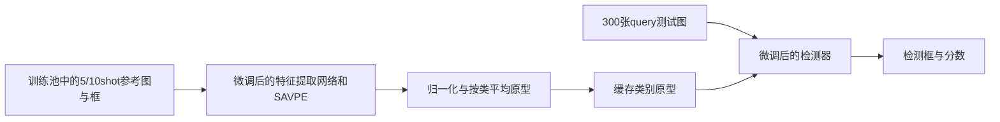

# YOLOE微调：哪些移除SAVPE，哪些保留视觉提示

2026-10-30新增`freeze_savpe=true`对照：在head/neck/full视觉提示范围内，保留但冻结全部SAVPE参数及BN统计，其余所选模块照常训练，推理继续使用5/10shot视觉提示。下文原搜索各VP范围“训练SAVPE”的说明对应未启用此标志的原配置。

- [叉车全部微调实验](../../outputs/YOLOE/finetune/chache_val300/comparisons/yoloe_search_20261029/ALL_EXPERIMENTS.md)、[冻结SAVPE成对实验](../../outputs/YOLOE/finetune/chache_val300/comparisons/yoloe_search_20261029/ALL_EXPERIMENTS.md)。
- [吊物全部微调实验](../../outputs/YOLOE/finetune/diaowu_val300/comparisons/yoloe_search_20261029/ALL_EXPERIMENTS.md)、[冻结SAVPE成对实验](../../outputs/YOLOE/finetune/diaowu_val300/comparisons/yoloe_search_20261029/ALL_EXPERIMENTS.md)。

新对照覆盖两个场景各7组可行配置：head/neck/full各两个学习率，加跨图neck。与原配置只改变SAVPE冻结条件。仅SAVPE范围启用此条件会拒绝执行，避免没有训练参数的假实验。

冻结SAVPE并不固定它的输出：backbone/neck更新后，其输入特征会变化，因此必须用当前模型重新提取参考原型。实现没有使用`no_grad`或`detach`切断上游梯度。训练结束记录模块参数与缓冲区SHA256、EMA一致性、其他参数更新及非零梯度，保存在`frozen_savpe_verification.json`。

本说明对应本项目已经执行的叉车、吊物实验及当前训练/推理实现。SAVPE是YOLOE的视觉提示编码模块（Semantic-Activated Visual Prompt Encoder），有时被误写成SAEVP。判断是否保留视觉提示能力，应同时看训练方法、参数清单和推理checkpoint结构，不能只看“全量”“head”或实验目录名。

## 先看结论

| 方法与配置 | SAVPE是否保留 | SAVPE是否微调 | 实际训练范围 | 最终推理是否使用视觉参考图 |
|---|---|---|---|---|
| `yoloe-head`，`strategy=head` | 移除 | 否 | 融合后固定分类头的输出层 | 否 |
| `yoloe-head`，`strategy=neck` | 移除 | 否 | neck和固定检测头 | 否 |
| `yoloe-head`，`strategy=full` | 移除 | 否 | backbone、neck、固定检测头 | 否 |
| `yoloe-vp`，`adaptation.scope=savpe` | 保留 | 是 | SAVPE | 是，5/10shot |
| `yoloe-vp`，`adaptation.scope=head` | 保留 | 是 | 检测头，包含SAVPE | 是，5/10shot |
| `yoloe-vp`，`adaptation.scope=neck` | 保留 | 是 | neck、检测头、SAVPE | 是，5/10shot |
| `yoloe-vp`，`adaptation.scope=full` | 保留 | 是 | backbone、neck、检测头、SAVPE | 是，5/10shot |
| 原始YOLOE视觉提示基线 | 保留 | 未微调 | 无训练 | 是，5/10shot |
| `yolov8`预训练权重微调 | 原结构没有 | 不适用 | backbone、neck、普通检测头 | 否 |

这里的“全量”指选定架构中的训练范围。**固定头全量微调已经移除了SAVPE；视觉提示全量微调保留且训练SAVPE。** 输入640/960/1024是另一项独立参数，不能据此判断是否使用视觉提示。“全量”仍遵守上游DFL固定投影等冻结例外，并不表示每个张量都更新。

两种检测头不能混为一谈：`yoloe-head`是固定类别的融合头方法；`yoloe-vp`的`scope=head`是保留视觉提示结构、训练整个检测头的方法。两者名称都含head，但结构与推理流程不同。

## 现有实验具体怎样分组

| 实验ID/来源 | 方法 | SAVPE状态 | 推理方式 |
|---|---|---|---|
| `head_linear_*`、`head_neck_*`、`head_full_*`及对应`_seed1/2` | 固定头微调 | 移除 | 图片直接检测，固定类别 |
| `baseline_head` | 基础固定头微调 | 移除 | 图片直接检测 |
| `vp_savpe_*` | 仅SAVPE微调 | 保留并训练 | SAVPE编码参考图片和框，生成类别原型 |
| `vp_head_*`、`vp_neck_*`、`vp_full_*`及对应种子复跑 | 扩大范围的视觉提示微调 | 保留并训练 | 同上 |
| `vp_cross_*`，包括`vp_cross_neck` | 跨图支持训练 | 保留并训练 | 同上；cross描述训练配对协议 |
| `vp_no_color`、`vp_no_aug` | 视觉提示增强对照 | 保留并训练 | 同上 |
| `baseline_vp` | 基础视觉提示微调 | 保留并训练 | 同上 |
| `baseline_yolov8` | 普通YOLOv8-L微调 | 不适用 | 图片直接检测 |

这张表用于读懂命名。逐个实验的最终分类以元数据为准，下面两张清单由报告脚本读取实际文件生成，并核验SAVPE参数清单和已有推理记录。

- 叉车：[叉车SAVPE方法速查](../../outputs/YOLOE/finetune/chache_val300/comparisons/yoloe_search_20261029/SAVPE_METHODS.md)、[完整结果](../../outputs/YOLOE/finetune/chache_val300/comparisons/yoloe_search_20261029/README.md)。
- 吊物：[吊物SAVPE方法速查](../../outputs/YOLOE/finetune/diaowu_val300/comparisons/yoloe_search_20261029/SAVPE_METHODS.md)、[完整结果](../../outputs/YOLOE/finetune/diaowu_val300/comparisons/yoloe_search_20261029/README.md)。

两套搜索都训练每类10张图片。VP测试中的5shot和10shot是**同一微调权重在推理时采用的参考数量**，不意味着另外训练了一个5shot模型。固定头和YOLOv8没有视觉参考数量这个推理维度。

### 已按dev选出的代表配置

| 场景 | 方法 | dev选定配置 | 训练范围 | 尺寸 | SAVPE |
|---|---|---|---|---:|---|
| 叉车 | 固定头 | `head_full_batch4` | backbone + neck + 固定检测头 | 640 | 移除 |
| 叉车 | 视觉提示 | `vp_cross_neck` | neck + 检测头 + SAVPE；跨图支持；检测损失 | 640 | 保留并微调 |
| 吊物 | 固定头 | `head_full_960` | backbone + neck + 固定检测头 | 960 | 移除 |
| 吊物 | 视觉提示 | `vp_full_lr0.0001` | backbone + neck + 检测头 + SAVPE；同图支持；检测损失 | 640 | 保留并微调 |

两项VP优胜配置均冻结SAVPE的BN运行统计，SAVPE卷积及BN仿射参数仍训练。种子复跑继承同一方法和训练范围。测试分数、标准差及候选冻结记录见各场景结果表；不能只凭固定头或YOLOv8分数评判视觉提示方法的效果。

### 旧叉车v1目录的歧义

历史记录里曾把固定头运行误叫作“vp”。当前正确归类如下，必须查看`finetune_config.json`中的实际`method`，不能把旧名字当证据：

| 当前训练目录（位于`outputs/YOLOE/finetune/chache_val300/runs/`） | 实际方法 | SAVPE |
|---|---|---|
| `yoloe_head_val100_v1` | `yoloe-head`，线性输出层微调 | 移除 |
| `yoloe_vp_10shot_val100_v1` | `yoloe-vp`，仅SAVPE微调 | 保留并训练 |
| `yolov8_val100_v1` | YOLOv8-L预训练权重微调 | 原结构没有 |

此前固定头诊断单独保存在[固定头v1报告](../../outputs/YOLOE/finetune/chache_val300/comparisons/yoloe_search_20261029/ALL_EXPERIMENTS.md)，不能当成视觉提示微调结果。失败的首次搜索保存在[历史归档](../../outputs/_shared/archive/comparisons/finetuning/chache_val300/yoloe_search_20261029_attempt01_failed/README.md)，不参与完成结果比较。

## 固定头方法为什么会移除SAVPE

`--method yoloe-head`先用配置里的类别文本和MobileCLIP生成文本embedding，再由`YOLOEPETrainer`把这些embedding融合为固定类别分类卷积。训练器先删除SAVPE，再通过头部`fuse()`融合分类输出并移除不再使用的文本对齐分支，之后优化融合后的模型。

因此，neck/full只是扩大这个固定架构的训练范围，不会把SAVPE加回来。最终模型直接输出既定类别，不从参考图重新构建类别原型。给它增加`--prompt-shots 5 10`无法恢复视觉提示能力，评估入口会按实际方法及结构做检查。

此方法保留了YOLOE预训练初始化的价值，适合作为固定类别监督适配对照；它不能代表“微调后依靠视觉参考图识别”的路线。



## 视觉提示方法怎样使用SAVPE

`--method yoloe-vp`使用保留SAVPE、未做固定类别融合的检测头。当前入口支持四种训练范围，范围越大，参与更新的模块越多，但都包含SAVPE。

训练有两种配对协议：

- `same_image`：用当前训练图的标注框生成视觉提示掩码，进行训练。这是训练阶段的监督；dev/test查询图的真值框不被当作提示输入。
- `cross_image`：从训练池中为各类别抽另一张支持图，排除整个当前query batch的图片，用其标注框提取原型，再监督query。它更直接模拟参考图与查询图不同的使用方式。

两种协议都保留SAVPE。它们都可与不同训练范围组合；`cross`并不自动表示训练backbone，`full`也不自动表示跨图训练。具体看`adaptation.protocol`和`adaptation.scope`。

损失另分为`classification`和`detection`。前者采用当前视觉适配的分类损失策略；后者优化box、cls、DFL检测损失。改变损失不等于删除SAVPE。代码里`criterion.hyp.load_vp=False`用于打开检测损失，模型的视觉提示训练入口仍启用，不能仅凭这一个标志判断提示模块是否工作。

### 最终5/10shot推理流程

1. 读取该场景冻结的5/10shot训练支持图及其框，不从dev/test提取参考。
2. 用微调后的模型提取支持图特征，把框转换为视觉掩码，交给SAVPE得到视觉embedding。
3. 各支持图embedding先归一化，按类求平均后再归一化，得到类别原型。
4. 将类别原型交给同一权重的检测器，逐类检测查询图片并汇总结果。



所以，“推理使用SAVPE”不表示每一张query都重新执行SAVPE。SAVPE在参考图编码阶段工作；固定参考集时原型可以缓存，query阶段复用。更换参考图或切换5/10shot，需要用相同微调权重重新提取原型。

另外，把原始seg模型转换为检测结构时去掉mask分支，只是不用实例分割输出；**去掉分割分支不等于移除SAVPE**。当前视觉提示微调使用detect结构，仍保留SAVPE。

## 冻结BN统计不等于冻结SAVPE

`freeze_savpe_bn_stats=true`会在训练时固定SAVPE中BatchNorm的运行均值与运行方差，避免小样本统计漂移。它不会将整个SAVPE设为不可训练：SAVPE卷积权重、BN的可学习缩放和偏置仍参与优化。

逐实验CSV中的`SAVPE`字段含义：

| 字段 | 含义 |
|---|---|
| `savpe_state` | `removed`为移除，`retained`为保留，`not_applicable`为原架构没有 |
| `savpe_present` | 最终架构是否含SAVPE |
| `savpe_finetuned` | 此训练范围是否包含SAVPE的可学习参数 |
| `uses_savpe_at_inference` | 是否用SAVPE编码推理参考图 |
| `savpe_bn_statistics` | 训练中BN统计`frozen`/`updated`，或`not_applicable`/`not_trained` |
| `training_range` / `inference_mode` | 实际训练范围及固定头/视觉提示推理方式 |

## 如何自己核对一个运行

首先查看训练目录的`finetune_config.json`：

```text
method = yoloe-head  → 固定头；strategy = head / neck / full
method = yoloe-vp    → 视觉提示；strategy及adaptation.scope = savpe / head / neck / full
method = yolov8      → 普通YOLOv8基线
```

再查看同目录的`trainable_parameters.json`：VP各范围有`.savpe.`参数；固定头没有。报告现在也归档该参数清单，方便在没有权重的机器上核对。

最后查看评估目录`dev_val100/*/run.json`或`test_val300/*/run.json`中的`checkpoint_structure`：VP应为`has_savpe=true`、`is_fused=false`；YOLOE固定头应为`has_savpe=false`、`is_fused=true`。YOLOv8按其自身检测结构判断。报告生成器会检查可用的结构记录是否与元数据一致，发现矛盾就报错，不加载权重执行推理。

可定位的实现入口：

- [训练方法、范围、BN统计策略](../../outputs/YOLOE/finetune/scripts/common/train.py)。
- [同图/跨图训练、训练支持集验证器与损失](../../outputs/YOLOE/finetune/scripts/common/vp_trainer.py)。
- [评估方法和checkpoint结构检查](../../outputs/YOLOE/finetune/scripts/common/evaluate.py)。
- [视觉提示参考图编码与推理](../../src/industrial_fewshot/detectors/yoloe_visual.py)。
- [报告方法分类及证据核验](../../src/industrial_fewshot/finetuning_methods.py)。

当前实验训练类别是固定的已见类别，但VP推理仍可用参考图构建原型；固定类别数量本身不代表已经放弃视觉提示。反过来，保留SAVPE也不能证明对未见类别仍有良好的开放词汇泛化，这需要另设未见类评估。

## 报告如何更新

在项目根目录执行下面的命令，只重新整理已有结果，不启动训练或推理：

```bash
python scripts/summarize_yoloe_optimization.py --stamp yoloe_search_20261029_r2
python scripts/summarize_yoloe_optimization.py --stamp yoloe_diaowu_search_20261029
```

`--stamp`仍是原运行ID，用于找到原训练和runtime文件；报告输出路径由[统一目录映射](../../src/industrial_fewshot/comparison_layout.py)决定。报告重命名不会改动训练权重路径、原运行ID或数据集。新目录入口见[comparisons索引](../../outputs/README.md)。

## 最终报告已精简

所有实验已完成。两场景各保留最高成绩、合并后的完整训练/test CSV和最佳结果原始证据。逐实验过程目录、重复报告与图表已压缩归档；本机档案位置与SHA256见各场景best_evidence.json。原始训练目录的元数据、权重和runtime配置没有移动。最终入口为[两个场景最高值对照](../../outputs/YOLOE/finetune/README.md)。
