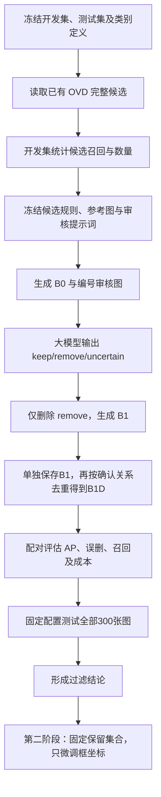

# OVD + 大模型过滤：分阶段实验计划

目标：先测量“只删除误检”能带来多少收益，再单独测量框坐标微调的额外收益。

当前状态：两场景共800张图的YOLOE候选、Qwen筛选/去重及坐标微调已完成，四个开发/测试队列均通过完整性校验。实际成绩、误删与成本见下方统一结果入口。

## 本轮实际执行与查看入口

[统一实验结果（开发/测试分开、所有阶段同表）](../comparisons/yoloe_qwen_filtering_20261030/README.md)。CSV/JSON在同一目录，详细预测与审计保存在各数据集的 `OVD-MLLM` 方法目录。

- 用户指定 Qwen 输入门槛为 **score≥0.01**，不再自动搜索或降低阈值。0.001仅是已生成原始YOLOE候选的存储下限，低于0.01的框不送入Qwen。
- 使用原始 `yoloe-v8l-seg.pt` 和每类冻结10shot视觉支持图；不是此前搜索得到的微调权重。
- Qwen3.8-27B 使用每类1张固定参考裁图，输入原图、编号框整图、1.5倍上下文裁图；每批最多20个待审候选。
- 按用户后续要求增加 **B1D：筛选后去重**。仅对Qwen明确确认的同类同实例重叠框去重，程序保留原分数最高的代表；B1仍单独保存，便于分离筛选和去重的贡献。
- 完成保留字段与候选集合校验后，B2只修改B1D的坐标，不改类别、分数及保留集合。
- 阈值搜索表与失败启动日志不作为实验成绩；保留成功响应缓存、正式预测、来源配置与评估记录。

复现和续跑（Linux，使用已装好的 `industrial-fewshot` 环境）：

```bash
# 候选生成有完整性检查，已完成的图像直接跳过。两场景可分配不同GPU。
python outputs/OVD-MLLM/scripts/generate_candidates.py --scene chache --device 0
python outputs/OVD-MLLM/scripts/generate_candidates.py --scene diaowu --device 1

# 开发集小批量验证；有效响应按真实输入签名缓存。
python outputs/OVD-MLLM/scripts/experiment.py --scene chache --pilot 2 --threshold 0.01
python outputs/OVD-MLLM/scripts/experiment.py --scene diaowu --pilot 2 --threshold 0.01

# 顺序完成各场景开发集与测试集；先落盘筛选/去重，再执行坐标微调。
python outputs/OVD-MLLM/scripts/experiment.py --scene chache --split both --threshold 0.01 --refine --concurrency 16
python outputs/OVD-MLLM/scripts/experiment.py --scene diaowu --split both --threshold 0.01 --refine --concurrency 8
python outputs/OVD-MLLM/scripts/summarize_experiment.py
```

同一场景、同一运行编号不要同时启动两个实例。改变模型、提示词、输入规则等需新建运行编号；重复执行相同配置会复用成功请求。实际进程和日志保存在 `outputs/_shared/runtime/ovd_mllm_filtering_20261030/`。

## 1. 对比组与固定条件

| 组别 | 操作 | 比较目的 |
|---|---|---|
| S0：原始 OVD | 保存原模型完整候选及原指标 | 原始成绩参照 |
| B0：待审候选基线 | 从 S0 按冻结阈值和候选上限筛选 | 记录候选筛选本身的影响 |
| B1：大模型过滤 | 对 B0 只执行保留或删除 | B1−B0 衡量过滤收益 |
| B1D：大模型去重 | 在B1上移除Qwen确认的同类同实例重复框 | B1D−B1衡量去重收益 |
| B2：过滤后框微调 | 固定 B1D 保留集合，只修改坐标 | B2−B1D 衡量定位收益，第二阶段开展 |

第一阶段做 S0/B0/B1/B1D。保留框的坐标、类别、置信度和原顺序必须与 B0 一致，不改类别、不补漏检、不重新打分、不额外执行 NMS。`uncertain` 和请求失败均保留原框，并单独统计。

## 2. 总体流程



## 3. 数据、模型和参考素材

先完成 chache 五类特种车辆，再按相同步骤扩展至 diaowu。每个 OVD 模型、权重、提示词、shot 和数据集分别形成独立的配对实验。

- chache 类别使用 `configs/common/chache_val300.yaml` 中的 Chache1、Chache2、Chache3、Chache4、Qianyinche；清除旧复核提示中的 Chache5 等历史表述。
- diaowu 沿用当前场景的类别和标注范围定义，不能在实验中临时改变吊具、吊索与吊物的包含规则。
- chache 优先核对已有100张开发集，确保与训练/参考池、300张测试集没有同图、近重复或同视频片段泄漏。diaowu 若缺独立开发集，先从测试集之外建立并冻结。
- 开发集用于选择候选规则和提示词。参数冻结后才运行固定300张测试，包含全部正、负样本。该测试集已有历史实验，不称为全新未观察测试集。
- 参考图从允许的训练/参考池选取，数量、清单和哈希固定，不使用开发/测试图作为参考。
- GT 仅参与离线评估和开发集参数选择，不进入审核图、候选排序、提示词或大模型请求。

首轮在开发集选择一个 OVD 来源，按候选召回和审核量选配置；不要直接按测试集 AP 选模型。验证流程后，再分别扩展 YOLOE、WeDetect、PET-DINO、GroundingDINO。

## 4. 步骤一：候选审计与 B0 冻结

1. 读取原实验的 `run.json`、`records.jsonl`、`metrics.json`，核对数据指纹、图片清单、类别、权重、提示词和支持集。缺少逐框记录时先补齐，不能由指标反推预测。
2. 使用完整 `records.jsonl`，不从通常已按0.5筛选的 `predictions/*.json` 恢复候选。原输出阈值以下被删掉的框无法通过后处理找回。
3. 给候选分配稳定 `candidate_id`，保存图片哈希、来源、原坐标、类别、分数和顺序。
4. 本轮按用户指定固定0.01，不搜索阈值，保留源模型每图每类最多100框（车辆五类最多500框）。开发集只报告候选数量与召回变化，不根据测试成绩调参。
5. 冻结规则后生成 B0。即使相对S0有召回损失，也如实报告；不再为满足原计划中的示例预算而把阈值降回0.001。

开发集候选表：

| 来源配置 | 阈值 | 全图上限 | 平均/P95候选数 | 忽略类别R@0.5 | 同类R@0.5 | 同类R@0.75 | 四项≤20%GT覆盖率 | 预计请求数 |
|---|---:|---:|---|---:|---:|---:|---:|---:|
| 待填写 | | | | | | | | |

忽略类别召回用于诊断定位覆盖；本阶段不改类别，所以同类召回同样必须报告。所有覆盖统计保留完整 GT 分母，不能只统计有预测的图片。

## 5. 步骤二：构造审核输入

每个请求包含固定类别说明和参考图、无标记原图、带候选编号的整图、本批候选的高清上下文裁图。只展示待审候选，不展示 GT。

实际每批最多20个待审候选，裁图宽高约为原框1.5倍。裁图窗口裁至图像内，保存原图与裁图的坐标映射。重叠候选尽量同批，大组分批时提供锚点作为上下文，但不提前删除候选或合并坐标；每个候选仍有独立编号。

默认不向大模型展示 OVD 分数，以减少分数暗示，原分数保留用于评估。零候选图片不调用模型，仍保留空预测和完整 GT。图片读取失败、请求失败均记录，不能从评估中排除图片。

本轮已单列B1D去重组。大模型只确认重复关系，不挑选“定位最好的框”；代表框由程序按原分数确定。只有两框均被明确保留、同类别且IoU≥0.5时才应用该关系；跨类冲突及不确定候选不擅自去重。

## 6. 步骤三：只删框审核

提示词核心约束：

```text
根据原图、编号框、局部裁图、类别定义与参考图审核本批候选。
已有框和标签只是待审假设，不是事实。
对每个 candidate_id 恰好返回一次：
keep：可见证据支持它属于当前类别。
remove：有明确证据表明是背景、非目标或不属于当前类别。
uncertain：遮挡、模糊、过小或证据不足，无法可靠判断。
不要因边界偏大、偏小或不完整就直接删除；目标成立时保留。
不得改坐标、类别或分数，不得新增框。明确同类同实例时可用duplicate_of指向输入中的另一编号，否则为null；代表框由程序决定。
只返回 candidate_id、decision、duplicate_of、简短视觉依据 reason，严格输出 JSON。
```

响应示例：

```json
{"reviews":[
  {"candidate_id":"p001","decision":"keep","reason":"可见当前类别的门架及车辆结构"},
  {"candidate_id":"p002","decision":"remove","reason":"框内是固定料架，无车辆结构"},
  {"candidate_id":"p003","decision":"uncertain","reason":"前部被遮挡，类别证据不足"}
]}
```

程序校验编号齐全、唯一、属于本批，决定合法且理由非空。限制重试次数；始终失败的批次沿用全部原框，标记 `review_failed`。B1 只删除 `remove`，其余框保持 B0 字段不变。错类候选可以被删除，但不能改成另一类，并单独记录这类删除。

成功请求按图片内容、候选清单、提示词、模型、参考图与请求参数缓存。改变输入即改变签名，相同成功请求复用，记录原始回答、重试和缓存命中。

## 7. 步骤四：开发集检查与冻结

1. 从开发集按固定清单选约20张流程检查图，覆盖正负例、多实例、遮挡和易混类别，检查编号和裁图，不按实验效果挑图。
2. 执行小批量 B1，人工核对删除依据、误删、uncertain、失败回退及框字段不变约束。
3. 在完整开发集评估 B0/B1，提示词修改均创建新版本；先分析误删和上下文缺失，再调整参数。
4. 冻结最终候选规则、模型版本、提示词、参考清单、批量、失败策略、评估器和主要指标。
5. 主要看 AP50:95 变化，同时报告 AP50、召回和成本；不能只因 Precision 上升就判定有效。无法保住召回时先修正过滤策略。

## 8. 步骤五：固定测试与统一汇总

固定配置后，在同一场景完整300张图上评估 S0/B0/B1。不针对测试案例修改提示词后只替换局部成绩；失败请求仅按原签名恢复。

B0/B1 使用相同 GT、类别、评估器、匹配方式及每图每类 maxDets。AP 使用每组全部保存分数，另在 score≥0.5、≥0.7 报告工作点。不得将失败或空预测图片从 GT 分母中移除。

| 指标 | 用途 |
|---|---|
| AP50、AP75、AP50:95、AP85/90/95 | 检测总体收益及高IoU下的变化 |
| 四项误差≤20% AP | 原框宽、高、横纵中心相对GT误差均合格的容差AP；不修改框，不额外要求IoU≥0.85 |
| TP/FP/FN、P/R/F1/F2 | 在固定分数和IoU工作点比较 |
| FP(B0)−FP(B1) | 误检净减少 |
| TP(B0)−TP(B1) | 全组重新一对一匹配后的有效检测净损失 |
| 基线TP/FP框被删比例 | 固定B0的匹配标记，分析删除对象 |
| uncertain与失败回退比例 | 审核覆盖与可靠性 |
| 请求数、token、缓存命中、总/每图耗时 | 审核成本 |

基线 TP 被删不一定导致目标漏检：可能由另一个保留框接替。必须同时报告按原编号统计的误删和重新匹配后的净损失。保存逐图前后对照及误删案例；若计算区间，按图片配对重采样，不把同图候选视为独立样本。

总体表统一包含 S0/B0/B1 及 B0−S0、B1−B0 差值，按数据集和 OVD 来源分组，逐类和整体同时报告。百分数指标的绝对差注明“百分点”。

## 9. 第二阶段：固定 B1，仅微调坐标

完成筛选/去重结果及保留字段校验后，再创建 B2。固定 B1D 的候选编号、保留集合、类别和原分数，提供原图与高清裁图，只允许修改坐标。请求失败、坐标非法或边界不确定时沿用 B1D 坐标，不再次筛框，不新增目标，不执行额外 NMS。

开发集先看框改好、改差和不变的比例，冻结规则后测试。比较 B2−B1D 的 AP75/85/90/95、四项≤20% AP 与定位退化实例，单独衡量改框贡献。

四项误差≤20%依赖GT，是评估条件；若限制实际修框幅度，须另行定义相对原预测框的范围，在开发集验证，不把两种20%混为同一概念。

## 10. 实现模块和结果目录

现有 `src/industrial_fewshot/legacy/review_annotations.py` 可复用原图、编号框、裁图、参考图和请求审计；其现有改类别、补漏检功能不属于本轮实验，需使用单独的只删框策略。评估复用 `src/industrial_fewshot/evaluation/detection_metrics.py` 与 `scripts/analyze_box_precision.py` 的指标定义。

`generate_candidates.py`负责YOLOE候选；`experiment.py`负责审核、缓存、去重、修框和配对评估；`summarize_experiment.py`统一汇总跨场景结果。实现已通过字段不变、编号校验、去重和坐标映射回归测试；实际成绩只以已保存的评估文件为准。

```text
outputs/OVD-MLLM/scripts/README.md
outputs/OVD-MLLM/experiments/<dataset>/
  experiment_results.md/csv/json     # 所有阶段在同一表中比较
  <ovd配置>_<审核模型>_<提示版本>_<运行编号>/
    experiment.json                 # 数据、来源、配置与输入哈希
    candidates.jsonl                # 冻结候选与编号
    reviews.jsonl                   # 审核决定、依据和失败记录
    baseline/                       # B0：records/run/metrics/evaluation
    filtered/                       # B1：保持完整图片清单
    deduplicated/                   # B1D：单独去重，保留原类别与分数
    refined/                        # B2开展时才创建
    previews/                       # 过滤前后对照
outputs/_shared/runtime/ovd_mllm_filtering/<运行编号>/
  status.json
  requests/                         # 输入与原始响应
  cache/
```

开发和测试使用不同运行编号及数据指纹。只读引用 S0 原实验，不覆盖其预测。总体汇总接入完成前，新流程结果仅在自己的统一表中报告，不声称已经纳入现有全项目总表。

## 11. 完成检查

- [ ] 开发/测试/参考池独立性与类别边界核查完成。
- [ ] 候选召回、数量、审核预算已统计并冻结。
- [ ] 小批量编号、裁图、无GT输入及失败恢复检查通过。
- [ ] B1确为B0子集，保留框坐标、类别、分数和顺序逐项一致。
- [ ] 完整开发集完成，参数冻结后评估全部300张测试图。
- [ ] 同一表包含S0/B0/B1、差值、逐类指标、误删案例与成本。
- [ ] 过滤结论明确后再实施B2，单独报告B2−B1。
