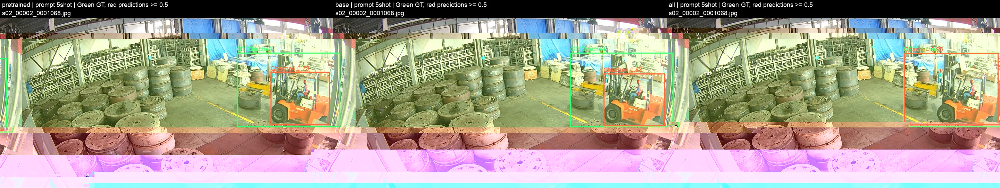
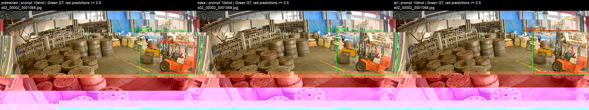

# Chache4 新类别视觉提示泛化

## 目的和对照

Chache4 在四类微调期间完全没有标注监督，训练完成后只加入它的参考图片与目标框，不再更新权重。
每类5张、10张各做一档，分别比较四类微调、五类微调、原始预训练权重，共六组。
四类为 Chache1、Chache2、Chache3、Qianyinche；五类条件额外包含 Chache4。
四类训练分别20/40张；五类训练分别25/50张。三种条件使用相同的每类K张冻结参考图（support seed=0）。
五类条件既使用Chache4图做梯度更新，也把同一批图用于推理提示；四类条件只在推理时使用它们。
预训练条件不做任何梯度更新。这里的“新类”仅指微调未见，不能保证原始预训练未见。

## 训练和选权重

沿用现有全量视觉提示微调：YOLOE-v8l-seg预训练权重转检测架构；backbone、neck、检测头及SAVPE参数都更新。
同图框条件训练（same_image）、完整检测损失；SAVPE的BN运行统计冻结，SAVPE可学习参数仍更新。
FP32、640输入、batch=4、AdamW、lr=0.0001、最多100epoch、patience=10、seed=0；无mosaic/mixup。
与既有5shot实验保持训练配方，仅按本实验协议改变训练类别和选权重的验证集。
原始100张验证集排除所有含Chache4标注的12张图，得到共同的88张验证图；包括30张背景图。
三组之间不使用Chache4验证性能调参、早停或挑权重，两种微调均按同一基础四类验证集的上游fitness选best.pt。
五类训练支持中有Chache4，但验证查询图没有Chache4；验证的四类AP用于选权重，不把无GT的Chache4 AP当0平均。
每个微调独占一张GPU：训练池仅20–50张，分布式通信和每卡极小batch开销不划算；不同实验并行。

## 测试口径

冻结的300张测试图全部保留，五类逐类提示查询后合并；不做跨类别NMS，和原有YOLOE评测一致。
每个模型一次评测五类，保存1500条请求；再将同一份GT和预测按标签投影为Chache4、基础四类、全五类三种范围。
Chache4主指标使用全部300张图：30个Chache4真值框，其他类别图/背景图仍计Chache4误检。
AP使用conf≥0.001、NMS IoU=0.7、每类最多100框；P/R/F1/F2使用score≥0.5、IoU=0.5，另保存score≥0.7。
三种条件的参考图、测试图、提示聚合（逐图归一化→均值→归一化）、输入大小和阈值完全相同。
推理时给Chache4生成新的视觉原型，无须把四类固定分类输出改成五类或重新训练。
所有支持图、训练图、验证图与测试图做字节哈希隔离；四类训练/验证禁止出现Chache4标注或Chache4支持图哈希。

## 如何执行

在仓库根目录、industrial-fewshot环境中：

```bash
python scripts/run_yoloe_novel_chache4.py --prepare
python scripts/run_yoloe_novel_chache4.py --launch
python scripts/run_yoloe_novel_chache4.py --status
python scripts/run_yoloe_novel_chache4.py --summarize
```

prepare仅创建新协议和数据；launch会运行四个微调与两组预训练对照，自动完成测试；summarize仅读取已保存预测/指标。
已完成任务不会重跑；已有未完成输出不覆盖。配置和完整日志位于`outputs/_shared/runtime/novel_chache4_20261102/`。
训练/权重保存在`outputs/YOLOE/finetune/chache_val300/runs/novel_chache4_20261102/`。
本页更新为最终汇总后，仍保留完整配置、协议、逐图记录和三种标签范围的指标。

## 如何解释

四类微调高于原始权重：说明基础类别微调有助于该新类的提示迁移；若低于原始权重，说明存在迁移损失或遗忘。
四类接近五类监督结果：支持“少做新类训练、换提示即可扩展”的价值；五类通常是有新类梯度监督的对照，不是无监督上界保证。
一组差异不能证明SAVPE优于所有固定头：此处测的是不增加新类优化步骤的适配能力。
仅一个held-out类别和一个seed，属于探索实验。没有按视频/相机重新划分，不能称为独立视频或新相机泛化。
参考标注只含所声明的类别；未标注的同图物体是否存在Chache4，仍需人工复核。

[协议与哈希](protocol.json)

## 完整测试结果

指标均为百分数。新类为Chache4；基础mAP是其余四类的平均。P/R/F1/F2取score≥0.5。

| 提示K | 条件 | 训练图数 | 新类训练K | 新类AP50 | 新类AP50:95 | 新类P | 新类R | 新类F1 | 新类F2 | 新类TP/FP/FN | 基础AP50 | 全五类AP50 |
|---:|---|---:|---:|---:|---:|---:|---:|---:|---:|---|---:|---:|
| 5 | [原始预训练＋视觉提示](../../runs/novel_chache4_20261102/pretrained_5shot/test_val300/novel/evaluation.txt) | 0 | 0 | 33.68 | 23.58 | 29.73 | 73.33 | 42.31 | 56.70 | 22/52/8 | 25.66 | 27.26 |
| 5 | [四类微调→新增Chache4提示](../../runs/novel_chache4_20261102/base_5shot/test_val300/novel/evaluation.txt) | 20 | 0 | 58.22 | 42.28 | 43.90 | 60.00 | 50.70 | 55.90 | 18/23/12 | 35.85 | 40.33 |
| 5 | [五类一起微调](../../runs/novel_chache4_20261102/all_5shot/test_val300/novel/evaluation.txt) | 25 | 5 | 66.82 | 58.31 | 45.95 | 56.67 | 50.75 | 54.14 | 17/20/13 | 36.40 | 42.49 |
| 10 | [原始预训练＋视觉提示](../../runs/novel_chache4_20261102/pretrained_10shot/test_val300/novel/evaluation.txt) | 0 | 0 | 41.89 | 31.43 | 32.50 | 86.67 | 47.27 | 65.00 | 26/54/4 | 25.78 | 29.00 |
| 10 | [四类微调→新增Chache4提示](../../runs/novel_chache4_20261102/base_10shot/test_val300/novel/evaluation.txt) | 40 | 0 | 59.04 | 34.59 | 90.91 | 33.33 | 48.78 | 38.17 | 10/1/20 | 40.91 | 44.53 |
| 10 | [五类一起微调](../../runs/novel_chache4_20261102/all_10shot/test_val300/novel/evaluation.txt) | 50 | 10 | 79.06 | 70.19 | 68.97 | 66.67 | 67.80 | 67.11 | 20/9/10 | 45.27 | 52.03 |

[完整CSV](results.csv) · [JSON与来源哈希](results.json) · [完整性与隔离检查](verification.json)

新类单类指标与现有总表的全五类mAP不是同一范围，因此单独汇总；全部原始预测和三种范围指标均保留。

5shot：四类微调后新增提示的Chache4 AP50较原始权重变化+24.54个百分点，较五类监督微调变化-8.60个百分点。其score≥0.5的召回为60.00%，AP改善与部署阈值下的召回改善应分开看。

10shot：四类微调后新增提示的Chache4 AP50较原始权重变化+17.15个百分点，较五类监督微调变化-20.02个百分点。其score≥0.5的召回为33.33%，AP改善与部署阈值下的召回改善应分开看。

实际完成轮数与基础验证集fitness最佳轮数见CSV；不同训练池和早停使优化步数不同，未按测试集挑轮数。

配置快照：[base_5shot](configs/base_5shot.json) · [all_5shot](configs/all_5shot.json) · [base_10shot](configs/base_10shot.json) · [all_10shot](configs/all_10shot.json) · [pretrained_5shot](configs/pretrained_5shot.json) · [pretrained_10shot](configs/pretrained_10shot.json)

可视化选冻结测试清单按文件名排序的首张Chache4正图，未按检测好坏挑图；绿色是真值，红色是score≥0.5预测。




